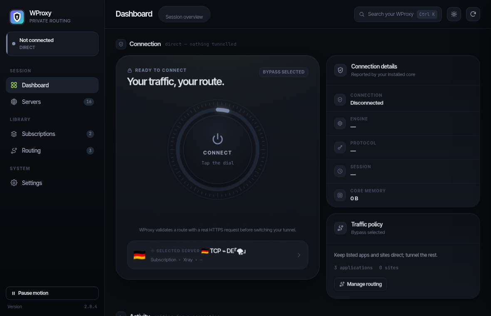

<p align="center">
  
</p>

<h1 align="center">WProxy</h1>

<p align="center">
  A desktop-first multi-engine proxy client for Linux and Windows.<br>
  GNOME Quick Settings · KDE Plasma 6 · Tauri desktop · split routing · CLI
</p>

<p align="center">
  <a href="https://github.com/Aliazadi-1776/WProxy-v2ray/releases/latest"></a>
  <a href="https://github.com/Aliazadi-1776/WProxy-v2ray/actions/workflows/ci.yml"></a>
  <a href="https://github.com/Aliazadi-1776/WProxy-v2ray/actions/workflows/windows-release.yml"></a>
  <a href="LICENSE"></a>
</p>

<p align="center">
  <a href="https://github.com/Aliazadi-1776/WProxy-v2ray/releases/tag/v2.8.4"><strong>Download v2.8.4</strong></a>
  · <a href="README.fa.md">راهنمای فارسی</a>
  · <a href="docs/ROUTING.md">Routing</a>
  · <a href="docs/WINDOWS.md">Windows</a>
  · <a href="docs/KDE.md">KDE setup</a>
  · <a href="docs/TESTING.md">Testing</a>
  · <a href="CHANGELOG.md">Changelog</a>
</p>

WProxy is a desktop client for your own proxy configuration or subscription; it does not supply a VPN account or default servers. It selects a compatible sing-box, Xray or Mihomo runtime and controls one system TUN. Version **2.8.4** brings the redesigned dark-and-lime Manager, measured traffic, a real application picker and the previously developed connection/recovery fixes. The Manager redesign keeps the connection engines and operating-system backend intact.

## Get WProxy

| Windows 10/11 x64 | GNOME 45–51 | KDE Plasma 6 |
| --- | --- | --- |
| Download **`WProxy-2.8.4-Setup.exe`** from the [latest release](https://github.com/Aliazadi-1776/WProxy-v2ray/releases/latest). | Install the distro dependencies below, then run `bash scripts/install.sh --desktop gnome`. | Install the distro and Plasma dependencies below, then run `bash scripts/install.sh --desktop kde`. |

The Windows installer includes WProxy, sing-box, Xray, Mihomo and Wintun. Linux uses the installed NetworkManager and system TUN stack. Review the [engine architecture](WPROXY_ENGINE_ARCHITECTURE.md) and [compatibility matrix](#compatibility) before installing on a new platform.

### Which file do I need?

| Release file | Purpose |
| --- | --- |
| `WProxy-2.8.4-Setup.exe` | Windows 10/11 **x64** installer; includes the application and engines. |
| `WProxy-2.8.4-GitHub.zip` | Linux/source package; extract it, install your distro dependencies, then run the installer below. Extracting it alone does not update an installed application. |
| `WProxy-2.8.4-Plasma6.plasmoid` | KDE panel widget; requires the WProxy backend. It is not a standalone VPN application. |
| `SHA256SUMS` / `Setup.exe.sha256` | Checksums for verifying the downloaded files. |

### First connection

1. Open **WProxy** from the application menu. Add your provider's URL under **Subscriptions**, or use **Servers → Add server** for a link or configuration file.
2. For a whole-device connection, open **Routing → All traffic**. **Only selected** requires at least one application or site; **Bypass selected** keeps the listed items direct.
3. On **Dashboard**, press the connection dial / **Quick connect** to select an HTTPS-working server, or choose **Connect** beside a specific server. To change server, press **Switch** on another row; Disconnect is in the Dashboard dial or active server's details.
4. Open a website in the browser you want to route. A TCP ping alone does not prove the tunnel works, and an application in the bypass list deliberately uses the direct connection.

For Windows installation and diagnostics, see [the Windows guide](docs/WINDOWS.md). For Fedora activation, SELinux or authorization errors, use the [Fedora recovery guide](docs/FEDORA.md) ([فارسی](docs/FEDORA.fa.md)).

To validate Linux dependencies, compile every native component and print the exact installation targets without changing the system, run `bash scripts/install.sh --desktop auto --dry-run`.

> [!IMPORTANT]
> Install this version to update the actual runtime; replacing a ZIP alone is not an upgrade. See the [connection fix and before/after tests](docs/CONNECTION-FIX-2.3.1.md).

## Screenshots

### Desktop Manager — 2.8.4

The redesigned Tauri Manager uses a dark interface with lime accents, a connection dial, live traffic cards, server filters and a searchable application picker. The screenshot below shows the disconnected Linux Manager with a local server library; it contains no connection credentials or subscription URLs.



### GNOME Quick Settings

Three visible server rows, scrolling for the rest, per-server latency and selection, and fixed subscription/action controls.


The GNOME screenshot is from version 2.2.10. The Manager redesign is separate from the GNOME and KDE panel widgets.

## Using the desktop Manager

The Manager's new frontend uses the existing connection engines, Tauri commands, NetworkManager service and Windows TUN backend.

| Page | What you can do |
| --- | --- |
| Dashboard | Connect with the dial or Quick connect; see the active server, engine, session time, memory and measured traffic. Quick connect uses the existing HTTPS-verified selection command. |
| Servers | Search and filter by source or engine, sort by latency or name, save favorites, switch between list/grid views, test latency and open server details. **Add server** accepts links, JSON/YAML or a file. |
| Subscriptions | Add a subscription, refresh it individually or refresh all, and see usage/expiry when the provider reports it. |
| Routing | Choose **All traffic**, **Only selected** or **Bypass selected**. Choose applications from the running/installed list or browse for an executable; add and remove sites separately. |
| Settings | Change theme and animation preferences, manage automatic updates and Linux authorization, inspect installed engines and run the connection check. |

Use **Ctrl+K** (**⌘K** on macOS keyboards) to find pages, actions and servers. Interface animations respect the operating system's reduced-motion setting and can be paused. Fonts and the SVG logo are bundled locally. Live status polling pauses while the window is hidden; the traffic graph uses measured counter changes and resets when the server changes. Missing measurements stay unknown.

After installing the dependencies below, build and open the native Manager without reinstalling the backend:

```bash
make desktop
./desktop/src-tauri/target/release/wproxy-desktop
```

For frontend development, `npm run dev` inside `desktop/` opens a **Design preview**. Browser preview data is illustrative; connection, import, routing and update actions require the installed/native Tauri application. Building the UI or viewing the preview does not establish a VPN connection.

## Features

- Import VLESS, VMess, Trojan, Shadowsocks, Hysteria 2, TUIC, WireGuard, SOCKS and HTTP links; add and update subscriptions.
- Import native sing-box/Xray JSON and Clash YAML/JSON without flattening proxy groups, providers or engine-specific options.
- Select sing-box, Xray or Mihomo from the profile's actual features and bundled core versions; validate with that core before switching.
- Connect/disconnect through NetworkManager on Linux or Wintun on Windows with only one core active.
- GNOME: a V2Ray tile beside Wi-Fi, with WProxy duplicates hidden from GNOME's native VPN dropdown.
- KDE Plasma 6: a WProxy panel/System Tray widget with server selection, per-server and batch ping, subscription input, update, and manager access.
- Three-row scrolling lists keep controls visible as the server count grows.
- Display remaining subscription traffic when the provider supplies usage information.
- One shared Tauri 2 desktop manager for Linux and Windows, plus the CLI and GTK3/GTK4 NetworkManager editors.
- Three routing modes: all traffic through VPN, bypass listed sites/apps, or only listed sites/apps through VPN.
- Desktop Connect and Quick connect test real HTTPS through the selected core before changing system routes; an open port alone cannot qualify a server.
- Opt-in verified automatic updates on Linux and Windows, using the release `SHA256SUMS` manifest before installation.
- Linux remembers limited WProxy approval after the first desktop connection; disable "Ask for permission once" in Settings to revoke it. Passwords are never saved.
- Windows 10/11 x64 Setup.exe with no separate Python or core install, a UTF-8-safe Tauri/WebView2 manager, subscription counts/source labels, native application picker and verified TUN control.

**Ping measures TCP connection latency to a server endpoint, not end-to-end VPN health.** A successful HTTPS-through-TUN test is stronger evidence than a ping result.

## Compatibility

The mature backend is Linux-specific: it needs a normal writable installation, systemd, NetworkManager and Linux TUN. Version 2.8.4 also provides a Windows x64 installer using the selected core's native TUN support. The two platforms share profile selection and routing rules but use different operating-system integration.

| Component / platform | Support and verification |
| --- | --- |
| GNOME Quick Settings | Metadata declares GNOME **45–51**; runtime/layout tested on **51.beta** only |
| KDE widget | Targets **Plasma 6**; Qt/Plasma component tests and isolated KPackage installation passed; a full KDE login/connection test is still pending |
| Backend | Linux + NetworkManager + sing-box/Xray/Mihomo with native TUN + Python 3 + PyYAML + iproute2 |
| Desktop manager and editors | Tauri 2/WebView manager, GTK3/GTK4 NetworkManager editors; WebKitGTK and GTK dependencies are needed even on KDE or with `--desktop none` |
| Ubuntu / Debian family | APT dependency fallback in the installer; live backend/GNOME verification was on Ubuntu **26.10 development**, x86_64, not every release |
| Arch / EndeavourOS / Manjaro | Manual dependency recipe below; installation and real connection not verified on these distributions |
| Fedora Workstation / KDE | Manual dependency recipe below; installation, SELinux integration and real connection not verified |
| openSUSE Tumbleweed | Manual dependency recipe below; installation, security-policy integration and real connection not verified |
| Cinnamon / Xfce / MATE / COSMIC / other desktops | No dedicated panel integration; `--desktop none` installs the backend + Tauri manager; desktop-specific testing pending |
| Plasma 5 / GNOME outside 45–51 | No supported panel frontend in this release |
| Windows 10/11 x64 | CI-built per-user Setup.exe bundles Tauri, sing-box 1.14.4, Xray 26.9.30, Mihomo 1.19.33 and Wintun; UAC is requested only for TUN connect/disconnect. Core schemas and the Windows executable are checked in CI, but physical Windows TUN execution for sing-box/Mihomo remains unverified. No custom Win+A tile |
| macOS / BSD | Not supported by WProxy frontends; no installer or desktop integration is supplied |
| NixOS / Alpine / immutable systems | These installation scripts are not supported; no Nix module, OpenRC, rpm-ostree or transactional installation is supplied |
| ARM / other CPU architectures | The Linux installer pins amd64 and arm64 sing-box/Mihomo packages; desktop and live TUN verification is still x86_64 only |

The separate KDE widget can sit beside Networks. The KDE installer also builds a native Plasma VPN plugin so Networks recognizes WProxy connections. Its editor preserves the saved configuration and opens Manager for changes; proxy credentials stay hidden. Qt/KF build dependencies are required only with KDE integration. The plugin factory/editor test passed against Plasma NM 6.7.5 on Fedora 44 and 6.8.2 on Arch; a complete KDE login/connection test is still pending.

Windows does not expose a public API for arbitrary third-party controls inside Win+A Quick Settings. WProxy therefore uses a normal standalone Tauri window. Windows' native VPN quick setting requires a curated VPN provider package and cannot host WProxy's custom server/subscription list. See [Windows support and limitations](docs/WINDOWS.md).

## Install

### 1. Open the source directory

Extract the ZIP, then open a terminal in the directory containing `Makefile` and `scripts/`. For this release archive:

```bash
cd WProxy-2.8.4
```

A GitHub “Download ZIP” may use a different folder name; enter that extracted folder instead. Run as your **normal desktop account**, not a root login, and leave Python virtual environments/Conda first. You need working Internet and permission to use `sudo`.

Use an already installed GNOME or Plasma desktop. Check **only the command for your desktop**:

```bash
gnome-shell --version
```

```bash
plasmashell --version
```

The GNOME extension requires 45–51; the KDE widget requires Plasma 6. A distro name alone does not imply either version. Do not install a second desktop just to satisfy the commands below.

### 2. Install your distribution's dependencies

Choose **one** distribution block. Install the common dependencies even on KDE: the source build includes the Tauri manager and both NetworkManager editors. Tauri needs Node.js **20.19+**, npm, Rust/Cargo **1.90+** and WebKitGTK 4.1. The KDE-only block is additional, not a replacement. These commands install dependencies; step 3 installs **WProxy itself**.

#### Debian / Ubuntu / Kubuntu / Linux Mint

For currently maintained Debian/Ubuntu-based systems with these packages available:

```bash
sudo apt-get update
sudo apt-get install -y \
  build-essential pkg-config libglib2.0-dev libgtk-3-dev libgtk-4-dev libnm-dev \
  libwebkit2gtk-4.1-dev librsvg2-dev libssl-dev \
  network-manager python3 python3-gi gir1.2-gtk-4.0 nodejs npm cargo \
  curl ca-certificates unzip iproute2 procps util-linux sudo pkexec
```

**Plasma 6 only**, also install:

```bash
sudo apt-get install -y \
  kpackagetool6 qml6-module-org-kde-kirigami \
  qml6-module-org-kde-plasma-plasma5support polkit-kde-agent-1 \
  cmake extra-cmake-modules qt6-base-dev libkf6coreaddons-dev \
  libkf6networkmanagerqt-dev libkf6widgetsaddons-dev plasma-nm
```

If these Plasma 6 packages are unavailable, stop: do not substitute Plasma 5 packages or mix repositories from another distro release. Use `--desktop none` or a distribution release with Plasma 6. Mint's default Cinnamon is **not** GNOME; use `--desktop none` there unless you separately run a supported desktop. If Ubuntu reports a missing package, check that the official repositories for your release (including Universe where applicable) are enabled.

#### Arch Linux / EndeavourOS / Manjaro

```bash
sudo pacman -Syu --needed \
  base-devel pkgconf glib2 glib2-devel gtk3 gtk4 libnm networkmanager \
  webkit2gtk-4.1 librsvg openssl nodejs npm rust \
  python python-gobject curl ca-certificates unzip iproute2 \
  procps-ng util-linux sudo polkit
```

This also performs a system upgrade; read the package manager's proposed transaction. Avoid partial upgrades. On derivatives, use their own repositories and update guidance.

**Plasma 6 only**, also install:

```bash
sudo pacman -S --needed kpackage kirigami plasma5support polkit-kde-agent \
  cmake extra-cmake-modules qt6-base kcoreaddons networkmanager-qt kwidgetsaddons plasma-nm
```

Arch's package names and PyGObject setup are documented in the [official GLib development package](https://archlinux.org/packages/core/x86_64/glib2-devel/), [KPackage file list](https://archlinux.org/packages/extra/x86_64/kpackage/files/) and [PyGObject installation guide](https://pygobject.gnome.org/getting_started.html).

#### Fedora Workstation / Fedora KDE (traditional, DNF-based installation)

```bash
sudo dnf install \
  gcc make pkgconf-pkg-config glib2-devel gtk3-devel gtk4-devel \
  NetworkManager NetworkManager-libnm-devel webkit2gtk4.1-devel \
  librsvg2-devel openssl-devel nodejs npm cargo rust \
  python3 python3-gobject gtk4 \
  curl ca-certificates unzip iproute procps-ng util-linux sudo polkit
```

**Plasma 6 only**, also install:

```bash
sudo dnf install kf6-kpackage kf6-kirigami plasma5support polkit-kde \
  cmake gcc-c++ extra-cmake-modules qt6-qtbase-devel kf6-kcoreaddons-devel \
  kf6-networkmanager-qt-devel kf6-kwidgetsaddons-devel plasma-nm
```

Package references: [NetworkManager development files](https://packages.fedoraproject.org/pkgs/NetworkManager/NetworkManager-libnm-devel/), [KPackage](https://packages.fedoraproject.org/pkgs/kf6-kpackage/kf6-kpackage/), [Plasma5Support](https://packages.fedoraproject.org/pkgs/plasma5support/plasma5support/). These instructions do **not** cover Silverblue, Kinoite, other Atomic variants, RHEL or CentOS. Keep SELinux enabled; investigate policy denials instead of disabling it to force an installation.

#### openSUSE Tumbleweed (traditional installation)

```bash
sudo zypper refresh
sudo zypper install \
  gcc make pkg-config glib2-devel gtk3-devel gtk4-devel 'pkgconfig(libnm)' \
  webkit2gtk3-devel librsvg-devel libopenssl-devel \
  NetworkManager nodejs20 npm20 cargo rust python3 python3-gobject python3-gobject-Gdk typelib-1_0-Gtk-4_0 \
  curl ca-certificates unzip iproute2 procps util-linux sudo polkit
```

`pkgconfig(libnm)` asks the package manager for the package providing the libnm development files.

**Plasma 6 only**, also install:

```bash
sudo zypper install kf6-kpackage kf6-kirigami-imports plasma5support6 polkit-kde-agent-6 \
  cmake extra-cmake-modules qt6-base-devel kf6-kcoreaddons-devel \
  kf6-networkmanager-qt-devel kf6-kwidgetsaddons-devel plasma6-nm
```

See the [upstream PyGObject/openSUSE instructions](https://pygobject.gnome.org/getting_started.html#opensuse) and [openSUSE Plasma5Support package](https://build.opensuse.org/package/show/openSUSE:Factory/plasma5support6). This is an **untested Tumbleweed recipe**, not a promise for every Leap/SUSE version. If a package is unavailable in your enabled official repositories, resolve the package/version difference first; do not add arbitrary third-party repositories. MicroOS/Aeon/Kalpa and transactional installations are not covered.

### 3. Check prerequisites, then install WProxy

Back in the source directory, these checks must succeed:

```bash
make check-deps
node --version
cargo --version
python3 -c "import gi; gi.require_version('Gtk', '4.0'); from gi.repository import Gtk; print('GTK4 / PyGObject: OK')"
command -v pkexec
nmcli general status
systemctl is-active NetworkManager
```

NetworkManager must already manage your Internet connection. If you currently use another network manager, follow your distro's migration instructions first; enabling two competing managers can disconnect you. On an already configured NetworkManager system where its service is merely stopped, use `sudo systemctl enable --now NetworkManager`.

For KDE, additionally check `kpackagetool6 --version` and keep the desktop's Polkit authentication agent running.

**Finally, run exactly one of the following installation commands:**

GNOME 45–51:

```bash
bash scripts/install.sh --desktop gnome
```

KDE Plasma 6:

```bash
bash scripts/install.sh --desktop kde
```

Backend + Tauri manager, without a panel frontend:

```bash
bash scripts/install.sh --desktop none
```

Or, inside a supported GNOME/Plasma session, `bash scripts/install.sh` detects the desktop automatically. The explicit forms above avoid ambiguity on derivatives.

The installer compiles the service/editors and uses sudo for system files. **Automatic missing-dependency installation is APT-only**; Arch/Fedora/openSUSE must complete step 2 first. If Xray is absent or older than **26.9.30**, the script downloads and runs the [official XTLS installer](https://github.com/XTLS/Xray-install) as root; review that trust decision before continuing. Every installed core is version-checked before WProxy is copied. Linux application routing additionally requires `systemd-run` so the selected core can inspect the originating process outside NetworkManager's restricted service sandbox.

Replaced WProxy files are backed up under `/var/backups/`. An upgrade stops WProxy temporarily but does not restart all of NetworkManager. This is a source installer, not a distro-managed DEB/RPM/Flatpak.

### 4. Load the desktop controls

**GNOME:** log out/in once, then run `gnome-extensions enable wproxy@wrench.local` if the tile is not enabled. Close/reopen GNOME Settings before using its VPN editor.

**KDE:** choose **Configure System Tray → Entries → WProxy → Always shown**. The installer repairs repeated panel instances and keeps one WProxy icon per panel. Log out/in once if Plasma retains cached QML. See [KDE setup](docs/KDE.md).

Check installation with `wproxyctl --version`, then open `wproxy-manager`, add your own subscription/server and connect. No working server credentials are bundled, and a successful installation alone does not prove a VPN connection works.

### Windows 10/11 installation

Download `WProxy-2.8.4-Setup.exe` and its `.sha256` file from the [v2.8.4 GitHub Release](https://github.com/Aliazadi-1776/WProxy-v2ray/releases/tag/v2.8.4), verify the checksum, and run Setup. Python and separate core downloads are not required. The per-user installer launches WProxy after installation; Windows requests Administrator approval only when connecting or disconnecting the TUN.

The installer contains pinned official sing-box **1.14.4**, Xray **26.9.30**, Mihomo **1.19.33** and Wintun files. Every downloaded archive has a fixed SHA-256. Read [the Windows guide](docs/WINDOWS.md) for use, routing and current verification limits.

### Upgrade an existing GNOME WProxy installation

```bash
bash scripts/apply-fix.sh --test
```

This updates the GNOME/runtime copies together, probes saved servers over local SOCKS, selects a working candidate, and checks NetworkManager activation, the actual TUN route and HTTPS. It saves a **local-only** `verification.txt`; do not commit diagnostic reports. It leaves a successful test connection active and disconnects after failed route/HTTPS checks.

## Use

Open **WProxy** from the application menu, or run:

```bash
wproxy-manager

# Add a subscription
wproxyctl sub add 'https://example.com/subscription'
wproxyctl sub update
sudo wproxyctl nm sync

# Inspect servers, then connect by ID
wproxyctl node list
wproxyctl node ping --all
wproxyctl nm up NODE_ID
wproxyctl nm down
wproxyctl status --json

# Split routing (the Tauri Routing page performs the same commands and sync)
wproxyctl routing mode bypass
wproxyctl routing domain add youtube.com
wproxyctl routing app add firefox
sudo wproxyctl nm sync
```

Panel controls request Polkit authentication when new/changed subscription profiles must be synced. This is expected. Keep a Polkit authentication agent running in your desktop session.

Deleting a node or subscription in **WProxy Manager** also synchronizes NetworkManager: its loaded WProxy entries are deleted from **Settings → VPN**, not just removed from `store.json`. Approve the Polkit dialog and close/reopen Settings if it was already open. With the CLI, run `sudo wproxyctl nm sync` after `node remove` or `sub remove`. This cleanup identifies WProxy by its service marker and deterministic per-user UUID; it does not delete unrelated VPN profiles.

On Linux, the graphical manager applies routing changes to the active tunnel automatically and restores the previous connection if activation fails. After CLI changes, run `sudo wproxyctl nm sync` and reconnect to apply them. On Windows, routing changes apply on the next connection. See [routing behavior, privacy implications and examples](docs/ROUTING.md).

## Build and test

The installation dependencies above do not include every developer test tool. Install Node.js from your distribution for `make test`; Qt/GNOME integration tests need the extra tools listed in [test coverage](docs/TESTING.md).

```bash
make check-deps
make all
make test

# Requires Qt 6 test tools, Kirigami and Plasma5Support QML
bash scripts/test-kde.sh

# Requires GNOME Shell 51; runs an isolated headless fixture
bash tests/headless-smoke.sh
```

The GitHub Actions workflow builds the backend/editors and runs unit, syntax, shell-quoting and package checks. Desktop integration tests are separate. See [test coverage and limitations](docs/TESTING.md).

## Troubleshooting and removal

Fedora users: see the [Fedora recovery guide](docs/FEDORA.md) for SELinux label
checks, activation/switch failures, Plasma support and scoped authorization.
[راهنمای فارسی فدورا](docs/FEDORA.fa.md)

```bash
bash scripts/diagnose.sh
sudo tail -n 60 /run/NetworkManager/wproxy/xray.log
journalctl -u NetworkManager -b

# Remove only the Plasma widget (no sudo)
bash scripts/uninstall-kde-widget.sh

# Remove WProxy program files and its generated NM profiles
bash scripts/uninstall.sh
```

The main uninstaller keeps the saved store in `~/.config/wproxy/` and the separately installed Xray core; bundled sing-box/Mihomo files are removed. Remove the KDE widget separately if installed. On GNOME, log out/in after extension changes.

## Privacy and security

The local store contains subscription URLs and proxy credentials. Do not publish `~/.config/wproxy/`, `%APPDATA%\WProxy`, NetworkManager profiles, generated core configs, or unredacted logs. Bypass/only rules can intentionally send selected traffic outside the VPN; the default remains all traffic through VPN. This repository includes source, synthetic test fixtures and the supplied screenshots—not a user's configuration store. See [security notes](SECURITY.md).

## License

WProxy source is licensed under the [MIT License](LICENSE). sing-box, Xray, Mihomo, Wintun and desktop/system projects remain separate works under their own licenses. Release installers bundle verified official cores and their notices; see [third-party notices](THIRD_PARTY_NOTICES.md).
